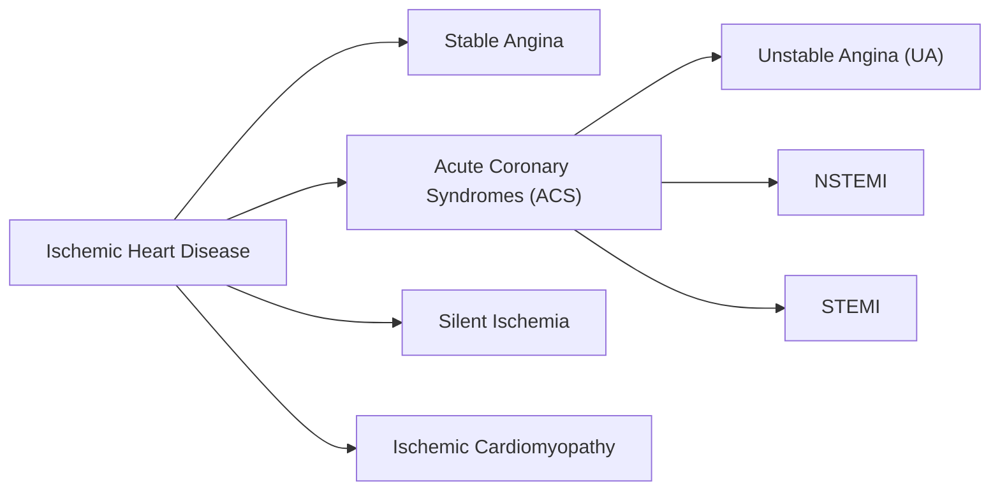

# Ischemic Heart Disease (IHD) — Comprehensive Overview

> [!IMPORTANT]
> This document is for **educational purposes only** and does not constitute medical advice. Always consult a qualified healthcare professional for diagnosis or treatment.

---

## 1. Definition

**Ischemic Heart Disease (IHD)**, also known as **Coronary Artery Disease (CAD)** or **Coronary Heart Disease (CHD)**, is a condition characterized by **reduced blood supply to the myocardium (heart muscle)** due to narrowing or blockage of the coronary arteries.

The word *ischemia* means **insufficient blood flow to meet the metabolic demands of tissue**, leading to oxygen deprivation (hypoxia) and nutrient deficiency.

---

## 2. Epidemiology

| Metric | Data |
|---|---|
| Global Prevalence | ~200 million people worldwide |
| Leading cause of death | #1 globally (WHO, 2023) |
| Annual deaths | ~9 million/year worldwide |
| Most affected | Men > Women (but risk equalizes post-menopause) |
| Peak age | Men: 45–65 | Women: 55–75 |

---

## 3. Anatomy & Pathophysiology

### 3.1 Coronary Artery Anatomy

The heart is supplied by **two main coronary arteries** arising from the aortic root:

```
Aorta
 ├── Left Coronary Artery (LCA)
 │    ├── Left Anterior Descending (LAD) → supplies anterior wall + septum
 │    └── Left Circumflex (LCx) → supplies lateral & posterior walls
 └── Right Coronary Artery (RCA) → supplies right ventricle + inferior wall
```

### 3.2 The Ischemic Cascade

When blood supply is reduced, events occur in a predictable sequence:

```
1. Perfusion ↓
       ↓
2. Metabolic changes (↓ ATP, ↑ lactate)
       ↓
3. Diastolic dysfunction (impaired relaxation)
       ↓
4. Systolic dysfunction (impaired contraction)
       ↓
5. ECG changes (ST depression/elevation)
       ↓
6. Angina (chest pain — if patient is symptomatic)
       ↓
7. Cell death (necrosis = Myocardial Infarction, if prolonged)
```

### 3.3 Atherosclerosis — The Core Mechanism

The primary underlying process is **atherosclerosis**:

1. **Endothelial injury** (from hypertension, smoking, diabetes, etc.)
2. **LDL infiltration** into the intima layer of the arterial wall
3. **Oxidation of LDL** → triggers inflammatory response
4. **Macrophage recruitment** → foam cell formation
5. **Fatty streak** formation (earliest visible lesion)
6. **Fibrous plaque** development with lipid core + fibrous cap
7. **Plaque vulnerability** → rupture or erosion
8. **Thrombus formation** → partial or complete arterial occlusion

> [!NOTE]
> A plaque does not need to be large to be dangerous. **Vulnerable plaques** (thin fibrous cap, large lipid core) are more likely to rupture than large, stable ones.

---

## 4. Classification / Clinical Spectrum

IHD presents across a spectrum:



### 4.1 Stable Angina
- Chest pain with **exertion or stress**, relieved by rest or nitrates
- Fixed plaque causing demand-supply mismatch
- Predictable, reproducible pattern
- No myocardial necrosis

### 4.2 Unstable Angina (UA)
- Rest pain, new-onset severe angina, or rapidly worsening angina
- Plaque rupture + partial thrombus (no complete occlusion)
- **No troponin elevation** (no necrosis)
- Medical emergency

### 4.3 NSTEMI (Non-ST-Elevation Myocardial Infarction)
- Partial coronary occlusion causing subendocardial infarction
- **Troponin elevated** (cell death occurred)
- No ST elevation on ECG
- ST depression or T-wave changes possible

### 4.4 STEMI (ST-Elevation Myocardial Infarction)
- **Complete occlusion** of coronary artery → transmural infarction
- **ST elevation on ECG** in affected territory
- Troponin markedly elevated
- **Time-critical emergency** (door-to-balloon < 90 min)

### 4.5 Silent Ischemia
- Ischemia without symptoms (common in diabetics due to autonomic neuropathy)
- Detected incidentally on stress test or Holter monitor

### 4.6 Ischemic Cardiomyopathy
- Chronic, diffuse ischemia causing **dilated, poorly functioning heart**
- End-stage consequence of repeated ischemic events

---

## 5. Risk Factors

### 5.1 Non-Modifiable
| Factor | Detail |
|---|---|
| Age | ♂ ≥45, ♀ ≥55 |
| Sex | Men at higher risk earlier in life |
| Family History | First-degree relative with early CAD |
| Genetics | Familial hypercholesterolemia, etc. |

### 5.2 Modifiable (Major)
| Factor | Mechanism |
|---|---|
| **Hypertension** | Endothelial shear stress, promotes atherosclerosis |
| **Dyslipidemia** | ↑ LDL, ↓ HDL drives plaque formation |
| **Diabetes Mellitus** | Glycation, inflammation, endothelial damage |
| **Smoking** | Oxidative stress, vasoconstriction, thrombogenicity |
| **Obesity** | Insulin resistance, inflammation, dyslipidemia |
| **Physical Inactivity** | Metabolic syndrome, hypertension |

### 5.3 Emerging Risk Factors
- Chronic kidney disease
- Inflammatory conditions (rheumatoid arthritis, lupus, psoriasis)
- Sleep apnea
- Air pollution / particulate matter
- Psychosocial stress / depression
- COVID-19 (post-infection cardiovascular risk)

---

## 6. Clinical Presentation

### 6.1 Classic Symptoms
- **Chest pain / pressure** — often described as "tight," "heavy," "squeezing"
- **Radiation** to left arm, jaw, neck, shoulder, or back
- **Dyspnea** (shortness of breath)
- **Diaphoresis** (sweating)
- **Nausea/vomiting**
- **Syncope or presyncope**

### 6.2 Atypical Presentations (Common in Women, Elderly, Diabetics)
- Fatigue, weakness
- Epigastric pain (indigestion-like)
- Back or jaw pain alone
- Palpitations
- No chest pain at all ("silent MI")

> [!WARNING]
> Women and diabetic patients frequently present **atypically** and are at higher risk of delayed diagnosis and worse outcomes.

---

## 7. Diagnosis

### 7.1 ECG Changes

| Condition | ECG Finding |
|---|---|
| Stable Angina | Normal at rest; ST depression on stress |
| Unstable Angina | ST depression, T-wave inversion |
| NSTEMI | ST depression, T-wave inversion + ↑ Troponin |
| STEMI | ST elevation (≥1 mm in 2 contiguous leads) → Q waves later |

### 7.2 Biomarkers
| Marker | Rise | Peak | Return to Normal |
|---|---|---|---|
| **Troponin I/T** (high-sensitivity) | 2–4 hours | 24–48 hours | 7–14 days |
| CK-MB | 4–6 hours | 12–24 hours | 48–72 hours |
| Myoglobin | 1–2 hours | 6–8 hours | 24 hours |

> [!TIP]
> **High-sensitivity Troponin (hs-cTn)** is now the gold standard. It enables rule-in/rule-out of MI within 1–3 hours using serial measurements.

### 7.3 Imaging & Investigations

| Test | Purpose |
|---|---|
| **Echocardiography** | Wall motion abnormalities, EF assessment |
| **Stress ECG (Exercise Test)** | Provocable ischemia detection |
| **Stress Echo / Nuclear (SPECT/PET)** | Myocardial perfusion imaging |
| **CT Coronary Angiography (CTCA)** | Non-invasive plaque/stenosis assessment |
| **Cardiac MRI** | Myocardial viability, scar tissue |
| **Invasive Coronary Angiography** | Gold standard for anatomy; allows intervention |
| **Fractional Flow Reserve (FFR)** | Functional significance of stenosis |

---

## 8. Treatment

### 8.1 Lifestyle Modifications (All Patients)
- **Smoking cessation** (most impactful single intervention)
- **Mediterranean or heart-healthy diet**
- **Regular aerobic exercise** (≥150 min/week moderate intensity)
- **Weight management** (target BMI 18.5–24.9)
- **BP control** (target <130/80 mmHg)
- **Blood glucose control** in diabetics
- **Stress management**

### 8.2 Pharmacological Treatment

#### Anti-anginals / Anti-ischemic
| Drug Class | Examples | Mechanism |
|---|---|---|
| **Nitrates** | Nitroglycerin, Isosorbide | Vasodilation (venodilation, ↓ preload) |
| **Beta-blockers** | Metoprolol, Bisoprolol | ↓ HR, ↓ contractility → ↓ O₂ demand |
| **Calcium Channel Blockers** | Amlodipine, Diltiazem | Vasodilation, ↓ HR (non-DHP) |
| **Ranolazine** | Ranexa | ↓ Late Na⁺ current, ↓ intracellular Ca²⁺ |
| **Ivabradine** | Procoralan | ↓ HR via If channel inhibition (sinus rhythm only) |

#### Disease-Modifying / Preventive
| Drug Class | Examples | Benefit |
|---|---|---|
| **Statins** | Atorvastatin, Rosuvastatin | ↓ LDL, plaque stabilization, anti-inflammatory |
| **Aspirin** | 75–100 mg/day | Antiplatelet (COX-1 inhibition) |
| **P2Y12 Inhibitors** | Clopidogrel, Ticagrelor, Prasugrel | Antiplatelet (ADP receptor blockade) |
| **ACE Inhibitors/ARBs** | Ramipril, Valsartan | Cardioprotective, anti-remodeling |
| **SGLT2 Inhibitors** | Empagliflozin, Dapagliflozin | ↓ CV death in diabetics; heart failure benefit |
| **GLP-1 agonists** | Semaglutide, Liraglutide | ↓ MACE in diabetics with CAD |
| **Ezetimibe / PCSK9 inhibitors** | Evolocumab, Alirocumab | ↓ LDL further when statins insufficient |

### 8.3 Revascularization

#### Percutaneous Coronary Intervention (PCI)
- Balloon angioplasty + **stent** placement
- **Drug-Eluting Stents (DES)** preferred (↓ restenosis)
- Preferred for **STEMI** (primary PCI within 90 min of arrival)
- Also used for significant stable angina not controlled medically

#### Coronary Artery Bypass Grafting (CABG)
- Surgical bypass using saphenous vein or internal mammary artery grafts
- Preferred for:
  - **Left main disease**
  - **Three-vessel disease**, especially with ↓ EF
  - Diabetics with multivessel disease
  - Complex anatomy not suitable for PCI

---

## 9. Complications

| Complication | Mechanism |
|---|---|
| **Heart Failure** | Loss of myocardium → pump failure |
| **Cardiogenic Shock** | Massive infarction → ↓ CO → ↓ perfusion |
| **Arrhythmias** | VF (leading cause of sudden death), VT, AF, AV blocks |
| **Mechanical Complications (post-MI)** | Papillary muscle rupture → MR; free wall rupture; VSD |
| **Pericarditis (Dressler syndrome)** | Autoimmune reaction weeks post-MI |
| **LV Aneurysm** | Scar tissue bulges → thrombus risk |
| **Sudden Cardiac Death** | Ventricular fibrillation |
| **Chronic Ischemic Cardiomyopathy** | Progressive heart failure |

---

## 10. Prognosis & Risk Scores

### Key Prognostic Factors
- **Ejection Fraction (EF)**: EF <40% → significantly worse prognosis
- **Number of vessels involved**
- **Presence of diabetes or CKD**
- **Revascularization success**
- **Medication adherence**

### Common Risk Scores
| Score | Use |
|---|---|
| **TIMI Score** | Risk stratification in ACS |
| **GRACE Score** | In-hospital + 6-month mortality in ACS |
| **SYNTAX Score** | Complexity of CAD for PCI vs CABG decision |
| **Framingham Risk Score** | 10-year cardiovascular risk in general population |
| **HEART Score** | ED chest pain evaluation |

---

## 11. Prevention

### Primary Prevention (Before Disease Develops)
- Aggressive risk factor control (statins, antihypertensives)
- Lifestyle modification
- Low-dose aspirin: **only in selected high-risk individuals** (not routine)
- Calcium score (CAC) for intermediate-risk patients

### Secondary Prevention (After Established IHD)
- **Dual antiplatelet therapy (DAPT)** post-ACS/PCI (aspirin + P2Y12 inhibitor)
- **High-intensity statin** (Atorvastatin 40–80 mg)
- **Beta-blocker** post-MI (at least 1–3 years)
- **ACE inhibitor/ARB** (especially with ↓ EF or diabetes)
- **Cardiac rehabilitation** (improves mortality by ~25%)

---

## 12. Special Populations

### Women
- Often present atypically; diagnosis delayed
- Microvascular disease more common (MINOCA)
- Worse outcomes post-MI

### Diabetics
- Silent ischemia common
- Accelerated atherosclerosis
- SGLT2i and GLP-1 agonists have proven CV mortality benefit

### Elderly
- More comorbidities, higher bleeding risk
- Benefit from revascularization still exists; tailor therapy

### Chronic Kidney Disease
- Independent CV risk factor
- Medication dosing adjustments needed
- Higher contrast nephropathy risk during angiography

---

## 13. Summary Table

| Aspect | Key Points |
|---|---|
| **Cause** | Atherosclerosis → coronary artery narrowing |
| **Main types** | Stable angina, UA, NSTEMI, STEMI |
| **Hallmark symptom** | Chest pain/pressure ± radiation |
| **Gold standard dx** | Invasive coronary angiography |
| **Emergency treatment** | Primary PCI within 90 min for STEMI |
| **Core medications** | Aspirin, statin, beta-blocker, ACEi |
| **Prevention** | Lifestyle + risk factor control |
| **Biggest killer** | Ventricular fibrillation (sudden cardiac death) |

---

*Document generated: November 6, 2026 | For educational use only.*
